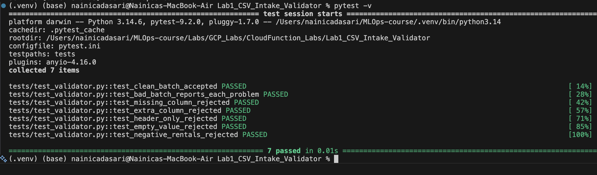
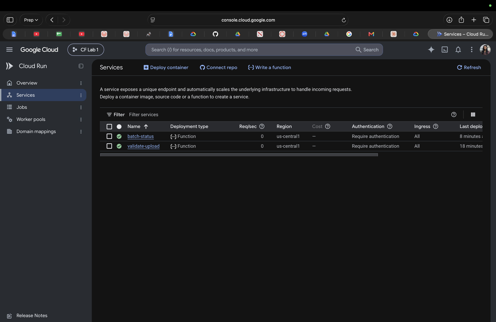
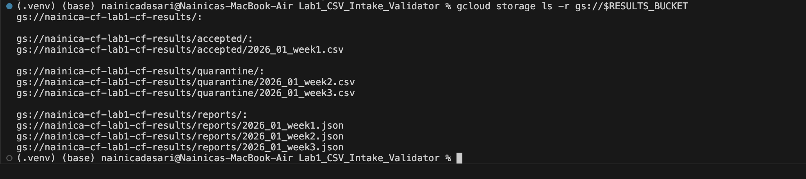
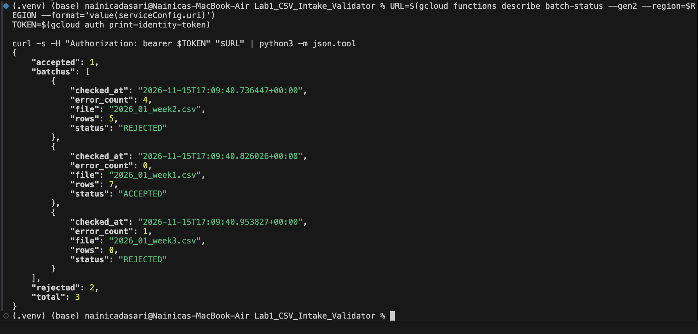
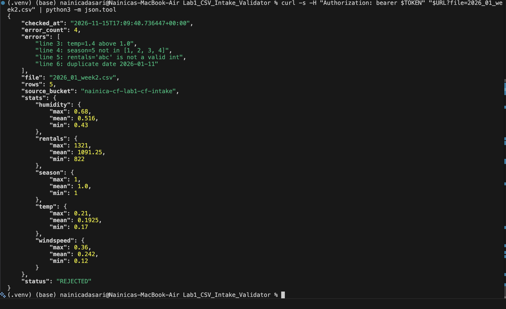
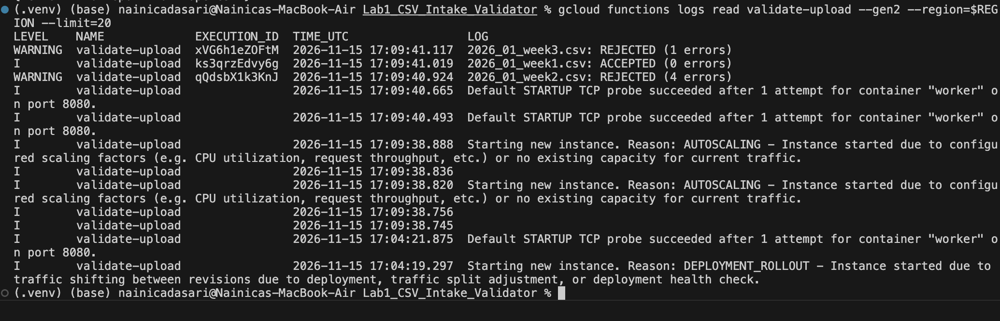
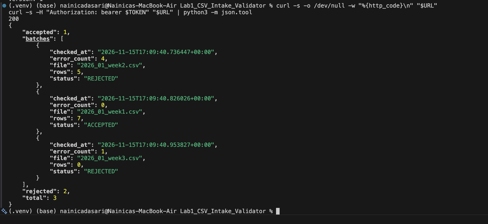

# Cloud Functions Lab: CSV Intake Validator

The purpose of this lab is to practice Google Cloud Functions (2nd gen): deploying event-driven and HTTP-triggered functions, wiring a Cloud Storage trigger through Eventarc, configuring IAM for functions and their service agents, and keeping an HTTP endpoint private.

## What the lab does

The lab builds a small data-intake pipeline for daily bike-rental CSV batches.

1. A CSV uploaded to the **intake bucket** triggers the `validate-upload` function.
2. The function validates the file against a fixed schema (required columns, types, value ranges, allowed values, duplicate dates).
3. The file is copied to `accepted/` or `quarantine/` in the **results bucket**, and a JSON report is written to `reports/`.
4. A structured log entry is written for each batch (INFO for accepted, WARNING for rejected).
5. The `batch-status` HTTP function returns a summary of all batches, or the full report for one file. It requires an identity token, so it isn't publicly accessible.

```
            upload CSV                          finalize event (Eventarc)
  user ───────────────► intake bucket ─────────────────────────────► validate-upload
                                                                          │
                                       ┌──────────────────────────────────┤
                                       ▼                                  ▼
                         results bucket                           Cloud Logging
                         ├── accepted/<file>.csv
                         ├── quarantine/<file>.csv
                         └── reports/<file>.json
                                       ▲
  user ── GET (identity token) ──► batch-status
```

The function writes to a separate results bucket. Writing back into the intake bucket would re-trigger the function in a loop.

## Validation rules

| Column      | Type  | Rule                     |
|-------------|-------|--------------------------|
| `date`      | date  | ISO format, no duplicates |
| `season`    | int   | one of 1, 2, 3, 4        |
| `temp`      | float | 0.0 to 1.0               |
| `humidity`  | float | 0.0 to 1.0               |
| `windspeed` | float | 0.0 to 1.0               |
| `rentals`   | int   | 0 or more                |

A file is rejected if it has missing or unexpected columns, no data rows, empty values, unparseable values, out-of-range values, or duplicate dates. Reports list up to 20 errors with their line numbers (line 1 is the header). The `stats` section (min, max, mean per numeric column) is computed from valid values only, so invalid values don't distort it.

## Project structure

```
Lab1_CSV_Intake_Validator/
├── main.py              # Cloud Functions: validate_upload (Storage trigger), batch_status (HTTP)
├── validator.py         # Validation logic, no GCP dependencies
├── requirements.txt     # Runtime dependencies deployed with the functions
├── pytest.ini
├── .gcloudignore        # Keeps tests, sample data and screenshots out of the deployment
├── .gitignore
├── tests/
│   └── test_validator.py
├── sample_data/
│   ├── 2026_01_week1.csv   # clean batch
│   ├── 2026_01_week2.csv   # row-level errors
│   └── 2026_01_week3.csv   # missing column
└── screenshots/
```

## Prerequisites

- Google Cloud SDK (`gcloud`) installed and logged in (`gcloud auth login`)
- A billing account
- Python 3.10+ for the local tests

## How to run

### 1. Run the unit tests locally

```bash
pip install pytest functions-framework google-cloud-storage
pytest -v
```

All 7 tests should pass.

### 2. Create a project and link billing

Replace `your-project-id` with a globally unique ID and `YOUR_BILLING_ACCOUNT_ID` with the ID from `gcloud billing accounts list`.

```bash
gcloud projects create your-project-id
gcloud billing projects link your-project-id --billing-account=YOUR_BILLING_ACCOUNT_ID
```

### 3. Set variables, enable APIs, create buckets

```bash
export PROJECT_ID=your-project-id
export REGION=us-central1
export INTAKE_BUCKET=${PROJECT_ID}-cf-intake
export RESULTS_BUCKET=${PROJECT_ID}-cf-results

gcloud config set project $PROJECT_ID
gcloud auth application-default set-quota-project $PROJECT_ID
export PROJECT_NUMBER=$(gcloud projects describe $PROJECT_ID --format='value(projectNumber)')

gcloud services enable cloudfunctions.googleapis.com run.googleapis.com \
  cloudbuild.googleapis.com eventarc.googleapis.com artifactregistry.googleapis.com \
  storage.googleapis.com pubsub.googleapis.com logging.googleapis.com

gcloud storage buckets create gs://$INTAKE_BUCKET --location=$REGION
gcloud storage buckets create gs://$RESULTS_BUCKET --location=$REGION
```

### 4. Configure IAM

New projects create their Google-managed service agents lazily, so create them explicitly before granting roles:

```bash
gcloud beta services identity create --service=storage.googleapis.com --project=$PROJECT_ID
gcloud beta services identity create --service=eventarc.googleapis.com --project=$PROJECT_ID
gcloud beta services identity create --service=pubsub.googleapis.com --project=$PROJECT_ID
```

Wait about a minute, then grant the roles:

```bash
# Cloud Storage agent publishes upload events
gcloud projects add-iam-policy-binding $PROJECT_ID \
  --member="serviceAccount:service-${PROJECT_NUMBER}@gs-project-accounts.iam.gserviceaccount.com" \
  --role=roles/pubsub.publisher

# Eventarc agent validates and reads the intake bucket
gcloud projects add-iam-policy-binding $PROJECT_ID \
  --member="serviceAccount:service-${PROJECT_NUMBER}@gcp-sa-eventarc.iam.gserviceaccount.com" \
  --role=roles/eventarc.serviceAgent
gcloud storage buckets add-iam-policy-binding gs://$INTAKE_BUCKET \
  --member="serviceAccount:service-${PROJECT_NUMBER}@gcp-sa-eventarc.iam.gserviceaccount.com" \
  --role=roles/storage.legacyBucketReader

# Function runtime service account reads/writes objects and receives events
export FN_SA=${PROJECT_NUMBER}-compute@developer.gserviceaccount.com
for ROLE in roles/storage.objectAdmin roles/eventarc.eventReceiver roles/run.invoker; do
  gcloud projects add-iam-policy-binding $PROJECT_ID \
    --member="serviceAccount:${FN_SA}" --role=$ROLE
done
```

Wait 3-5 minutes for the permissions to propagate.

### 5. Deploy the functions

```bash
gcloud functions deploy validate-upload --gen2 --runtime=python312 --region=$REGION \
  --source=. --entry-point=validate_upload \
  --trigger-bucket=$INTAKE_BUCKET \
  --set-env-vars=RESULTS_BUCKET=$RESULTS_BUCKET

gcloud functions deploy batch-status --gen2 --runtime=python312 --region=$REGION \
  --source=. --entry-point=batch_status --trigger-http --no-allow-unauthenticated \
  --set-env-vars=RESULTS_BUCKET=$RESULTS_BUCKET
```

Both should end with `state: ACTIVE`.

### 6. Upload the sample batches

```bash
gcloud storage cp sample_data/*.csv gs://$INTAKE_BUCKET/
sleep 45
gcloud storage ls -r gs://$RESULTS_BUCKET
```

### 7. Query the results

```bash
URL=$(gcloud functions describe batch-status --gen2 --region=$REGION --format='value(serviceConfig.uri)')
TOKEN=$(gcloud auth print-identity-token)

curl -s -H "Authorization: bearer $TOKEN" "$URL" | python3 -m json.tool
curl -s -H "Authorization: bearer $TOKEN" "$URL?file=2026_01_week2.csv" | python3 -m json.tool
curl -s -H "Authorization: bearer $TOKEN" "$URL?file=nope.csv"
curl -s -o /dev/null -w "%{http_code}\n" "$URL"

gcloud functions logs read validate-upload --gen2 --region=$REGION --limit=20
```

## Expected results

| Check | Expected |
|---|---|
| `pytest -v` | 7 passed |
| Results bucket | `accepted/2026_01_week1.csv`; `quarantine/2026_01_week2.csv` and `2026_01_week3.csv`; three reports in `reports/` |
| Summary | `total: 3`, `accepted: 1`, `rejected: 2` |
| Week 2 report | 4 errors: `temp=1.4 above 1.0` (line 3), `season=5 not in [1, 2, 3, 4]` (line 4), `rentals='abc' is not a valid int` (line 5), `duplicate date 2026-01-11` (line 6) |
| Week 3 report | 1 error: `missing columns: ['humidity']` |
| Unknown file | `404` with `{"error": "no report for nope.csv"}` |
| Request without token | `403` |
| Logs | week 1 at INFO, weeks 2 and 3 at WARNING |

## Screenshots

**Unit tests**



**Deployed functions (both require authentication)**



**Results bucket after upload**



**Batch summary from `batch-status`**



**Report for the rejected week 2 batch**



**Function logs**



**Endpoint rejects requests without a token**



## Troubleshooting

| Problem | Cause and fix |
|---|---|
| `Service account service-...@gs-project-accounts... does not exist` | The Storage agent hasn't been created yet. Run the `services identity create` commands in step 4, wait a minute, retry. |
| Deploy fails with `storage.buckets.get denied ... Eventarc service account` | Eventarc permissions haven't propagated. Confirm the step 4 bindings, wait 5 minutes, redeploy. |
| Results bucket stays empty after upload | Check `gcloud functions logs read validate-upload ...`. If the files were uploaded before permissions propagated, the events were dropped (the trigger doesn't retry). Upload the files again. |
| `batch-status` shows "Public access" in the console | Run `gcloud run services remove-iam-policy-binding batch-status --region=$REGION --member=allUsers --role=roles/run.invoker` and `gcloud run services update batch-status --region=$REGION --invoker-iam-check`. |
| curl returns 403 even with a token | Identity tokens expire after about an hour. Rerun `TOKEN=$(gcloud auth print-identity-token)`. |
| `zsh: command not found: #` | zsh doesn't accept comments pasted at the prompt. It's harmless. |

## Cleanup

Deleting the project removes the functions, buckets and all other resources:

```bash
gcloud projects delete $PROJECT_ID
```
