# Cloud Functions Lab: Model Promotion Pipeline

The purpose of this lab is to practice building a serverless machine learning pipeline on Google Cloud using Cloud Functions, Cloud Storage, Pub/Sub and Workflows.

## The idea in one sentence

Every time new data arrives, the pipeline trains a new model and only puts it into use if it is better than the model already in use.

The model in use is called the **champion**. The newly trained model is called the **challenger**.

## How it works

There are three small functions and one workflow.

1. **process-data** runs automatically when a data file is uploaded. It removes bad rows, splits the data into a training part (80%) and a testing part (20%), and sends a message to start training.
2. **train-model** runs when it receives that message. It trains the challenger and tests both the challenger and the champion on the same test data. If the challenger's error is at least 2% lower, it becomes the new champion. Otherwise the champion stays. The decision is saved and also sent out as a message.
3. **serve-model** is a private web endpoint. It makes predictions using the current champion and shows the history of past runs.
4. **The workflow** runs everything for one data file: it starts the pipeline, waits until the decision is made, checks that predictions work, and shows a summary.

```
 workflow ──► copies file into raw bucket
                    │
                    ▼
              process-data ──► cleans and splits the data
                    │
                    │  message
                    ▼
              train-model ──► trains challenger, compares with champion,
                    │         saves the decision
                    │  message
                    ▼
              model-events (decision log)

 workflow ──► asks serve-model for the result and tests a prediction
```

### Terms used

- **MAE (mean absolute error):** how far off the model's predictions are, on average. Lower is better.
- **Pub/Sub:** a messaging service that lets one function tell another to start.
- **Bucket:** a folder in Google Cloud Storage.

## The data

The data is daily bike rentals. The model predicts `rentals` from `season`, `temp`, `humidity`, `windspeed` and `workingday`.

`data/generate_data.py` creates three files, each made to test a different outcome:

| File | What it represents | What should happen |
|---|---|---|
| `batch_01.csv` | normal demand | Becomes champion (there is no champion yet) |
| `batch_02.csv` | demand has grown a lot, plus 20 bad rows | Becomes champion (the old model is now far off) |
| `batch_03.csv` | data from a faulty, noisy counter | Rejected (the new model is worse, so batch_02 stays champion) |

## Folder structure

```
Lab2_Model_Promotion_Pipeline/
├── data/
│   ├── generate_data.py      creates the three data files
│   ├── batch_01.csv
│   ├── batch_02.csv
│   └── batch_03.csv
├── src/
│   ├── data_processing/      process-data function
│   ├── training/             train-model function
│   └── serving/              serve-model function
├── workflow.yaml             the workflow
├── screenshots/
└── README.md
```

Everything the pipeline produces is saved in the artifacts bucket:

```
incoming/                 data files waiting to be run
processed/<run>/          the cleaned training and testing data
models/<run>/             every trained model
registry/champion.json    which model is the current champion
registry/runs/<run>.json  the decision for each run
```

## How to run it

You need the Google Cloud CLI (`gcloud`), a billing account, and Python with `pandas` and `numpy`.

### Step 1: Create the data

```bash
pip install pandas numpy
python data/generate_data.py
```

### Step 2: Create a project

Replace `your-project-id` and `YOUR_BILLING_ACCOUNT_ID` with your own values.

```bash
gcloud projects create your-project-id
gcloud billing projects link your-project-id --billing-account=YOUR_BILLING_ACCOUNT_ID
```

### Step 3: Set up the project

```bash
export PROJECT_ID=your-project-id
export REGION=us-central1
export RAW_BUCKET=${PROJECT_ID}-raw
export ARTIFACT_BUCKET=${PROJECT_ID}-artifacts

gcloud config set project $PROJECT_ID
gcloud auth application-default set-quota-project $PROJECT_ID
export PROJECT_NUMBER=$(gcloud projects describe $PROJECT_ID --format='value(projectNumber)')
echo $PROJECT_NUMBER
```

The last line must print a number. Then turn on the services and create the buckets and message topics:

```bash
gcloud services enable cloudfunctions.googleapis.com run.googleapis.com \
  cloudbuild.googleapis.com eventarc.googleapis.com artifactregistry.googleapis.com \
  storage.googleapis.com pubsub.googleapis.com logging.googleapis.com \
  workflows.googleapis.com workflowexecutions.googleapis.com

gcloud storage buckets create gs://$RAW_BUCKET --location=$REGION
gcloud storage buckets create gs://$ARTIFACT_BUCKET --location=$REGION

gcloud pubsub topics create model-training-trigger
gcloud pubsub topics create model-events
gcloud pubsub subscriptions create model-events-audit --topic=model-events
```

### Step 4: Give permissions

Google Cloud services need permission to talk to each other. First create the service accounts Google uses behind the scenes:

```bash
gcloud beta services identity create --service=storage.googleapis.com --project=$PROJECT_ID
gcloud beta services identity create --service=eventarc.googleapis.com --project=$PROJECT_ID
gcloud beta services identity create --service=pubsub.googleapis.com --project=$PROJECT_ID
```

Wait one minute, then give the permissions:

```bash
gcloud projects add-iam-policy-binding $PROJECT_ID \
  --member="serviceAccount:service-${PROJECT_NUMBER}@gs-project-accounts.iam.gserviceaccount.com" \
  --role=roles/pubsub.publisher

gcloud projects add-iam-policy-binding $PROJECT_ID \
  --member="serviceAccount:service-${PROJECT_NUMBER}@gcp-sa-eventarc.iam.gserviceaccount.com" \
  --role=roles/eventarc.serviceAgent

gcloud storage buckets add-iam-policy-binding gs://$RAW_BUCKET \
  --member="serviceAccount:service-${PROJECT_NUMBER}@gcp-sa-eventarc.iam.gserviceaccount.com" \
  --role=roles/storage.legacyBucketReader

export FN_SA=${PROJECT_NUMBER}-compute@developer.gserviceaccount.com
for ROLE in roles/storage.objectAdmin roles/pubsub.publisher roles/eventarc.eventReceiver roles/run.invoker; do
  gcloud projects add-iam-policy-binding $PROJECT_ID --member="serviceAccount:${FN_SA}" --role=$ROLE
done

gcloud iam service-accounts create workflow-runner --display-name="Model promotion workflow"
export WF_SA=workflow-runner@${PROJECT_ID}.iam.gserviceaccount.com
for ROLE in roles/storage.objectAdmin roles/run.invoker roles/logging.logWriter; do
  gcloud projects add-iam-policy-binding $PROJECT_ID --member="serviceAccount:${WF_SA}" --role=$ROLE
done
```

Wait 3-5 minutes before the next step so the permissions take effect.

### Step 5: Deploy the three functions

Each one takes a few minutes.

```bash
gcloud functions deploy process-data --gen2 --runtime=python312 --region=$REGION \
  --source=src/data_processing --entry-point=process_data \
  --trigger-bucket=$RAW_BUCKET --memory=1GiB --timeout=120s \
  --set-env-vars=PROJECT_ID=$PROJECT_ID,ARTIFACT_BUCKET=$ARTIFACT_BUCKET,TRAINING_TOPIC=model-training-trigger

gcloud functions deploy train-model --gen2 --runtime=python312 --region=$REGION \
  --source=src/training --entry-point=train_model \
  --trigger-topic=model-training-trigger --memory=1GiB --timeout=300s \
  --set-env-vars=PROJECT_ID=$PROJECT_ID,ARTIFACT_BUCKET=$ARTIFACT_BUCKET,EVENTS_TOPIC=model-events

gcloud functions deploy serve-model --gen2 --runtime=python312 --region=$REGION \
  --source=src/serving --entry-point=serve \
  --trigger-http --no-allow-unauthenticated --memory=1GiB --timeout=60s \
  --set-env-vars=ARTIFACT_BUCKET=$ARTIFACT_BUCKET
```

### Step 6: Deploy the workflow

```bash
export SERVING_URL=$(gcloud functions describe serve-model --gen2 --region=$REGION --format='value(serviceConfig.uri)')

gcloud workflows deploy model-promotion --location=$REGION \
  --source=workflow.yaml --service-account=$WF_SA \
  --set-env-vars=RAW_BUCKET=$RAW_BUCKET,ARTIFACT_BUCKET=$ARTIFACT_BUCKET,SERVING_URL=$SERVING_URL
```

### Step 7: Run the pipeline

Upload the data files, then run them one at a time, in order:

```bash
gcloud storage cp data/batch_*.csv gs://$ARTIFACT_BUCKET/incoming/

gcloud workflows run model-promotion --location=$REGION --data='{"file":"batch_01.csv"}'
gcloud workflows run model-promotion --location=$REGION --data='{"file":"batch_02.csv"}'
gcloud workflows run model-promotion --location=$REGION --data='{"file":"batch_03.csv"}'
```

### Step 8: Check the results

```bash
TOKEN=$(gcloud auth print-identity-token)

# See the champion and all past runs
curl -s -H "Authorization: bearer $TOKEN" "$SERVING_URL" | python3 -m json.tool

# Get predictions
curl -s -X POST -H "Authorization: bearer $TOKEN" -H "Content-Type: application/json" \
  -d '{"instances":[{"season":3,"temp":0.7,"humidity":0.5,"windspeed":0.15,"workingday":1},{"season":1,"temp":0.2,"humidity":0.8,"windspeed":0.3,"workingday":0}]}' \
  "$SERVING_URL" | python3 -m json.tool

# Check the endpoint is private (should print 403)
curl -s -o /dev/null -w "%{http_code}\n" "$SERVING_URL"

# See the decision messages
gcloud pubsub subscriptions pull model-events-audit --auto-ack --limit=10

# See the saved files
gcloud storage ls -r gs://$ARTIFACT_BUCKET/registry gs://$ARTIFACT_BUCKET/models

# See the training logs
gcloud functions logs read train-model --gen2 --region=$REGION --limit=20
```

## What you should see

The exact error numbers may differ slightly, but the decisions should be the same.

| Run | Decision | Model in use after the run |
|---|---|---|
| batch_01 | PROMOTED (no champion yet) | batch_01 |
| batch_02 | PROMOTED (error about 260 vs about 1,480 for the old model) | batch_02 |
| batch_03 | REJECTED (error about 730 vs about 674 for the champion) | batch_02 |

Also:
- Predictions come from `batch_02`.
- A request without a token gets `403`, so the endpoint is private.
- The decision log has three messages.
- 20 bad rows were removed from batch_02.

## Screenshots

**The three functions, all private**

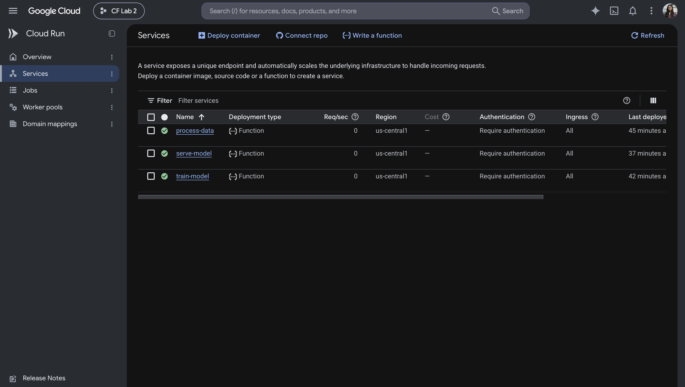

**batch_01: promoted**

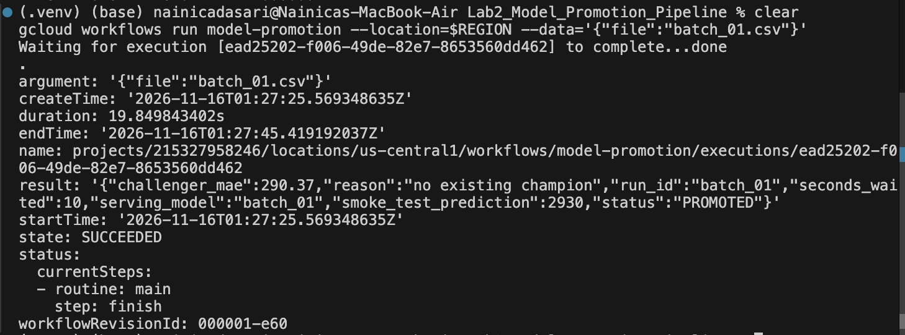

**batch_02: promoted**

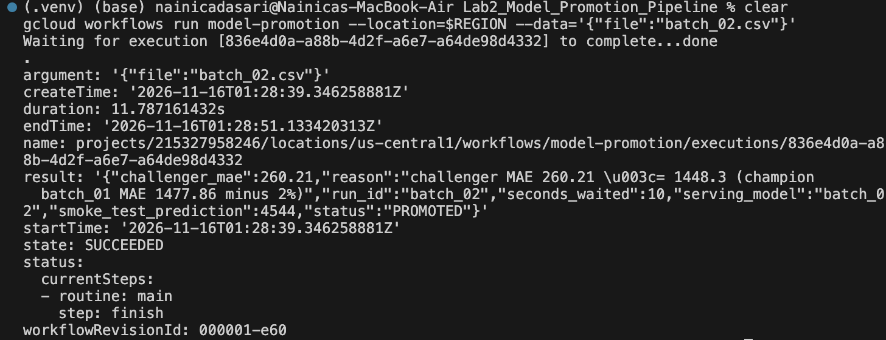

**batch_03: rejected, batch_02 is still in use**

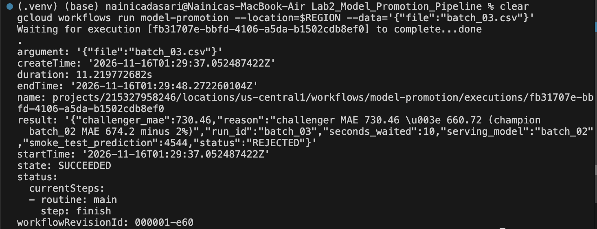

**Workflow runs in the console**

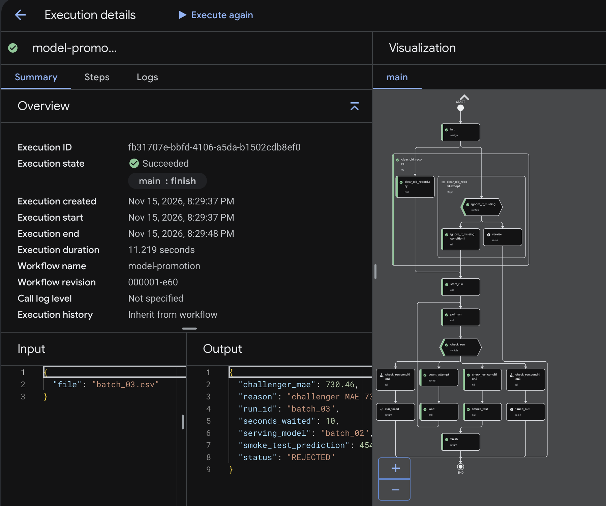

**Champion and run history**

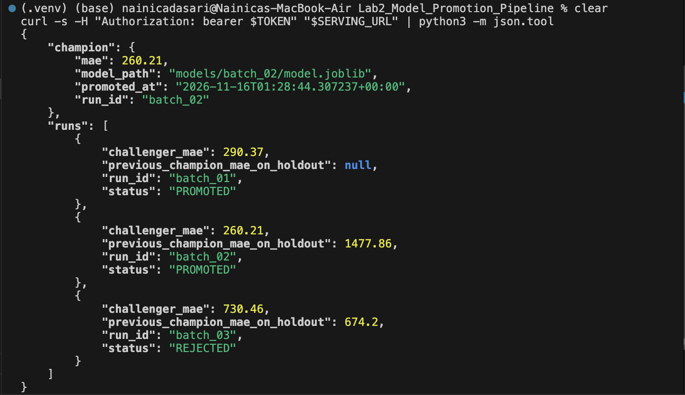

**Predictions**

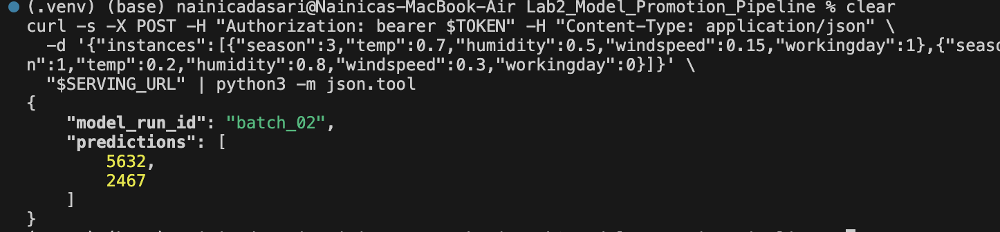

**Decision messages**

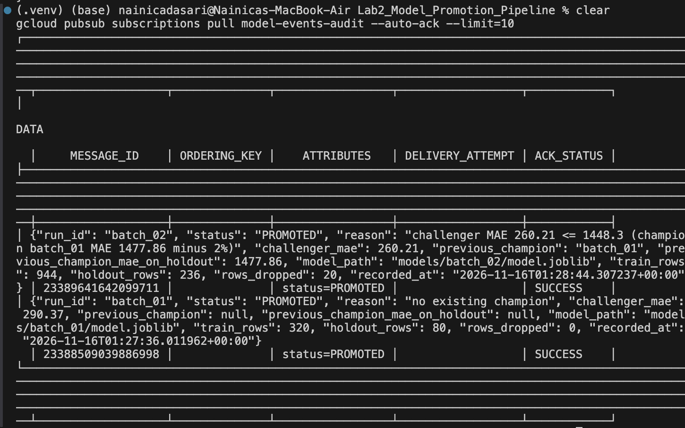

**Saved files**

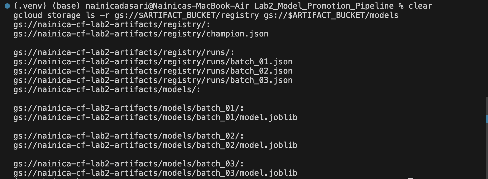

**Training logs**

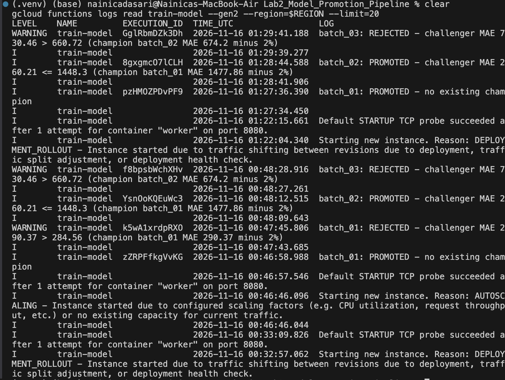

**Request without a token is blocked**

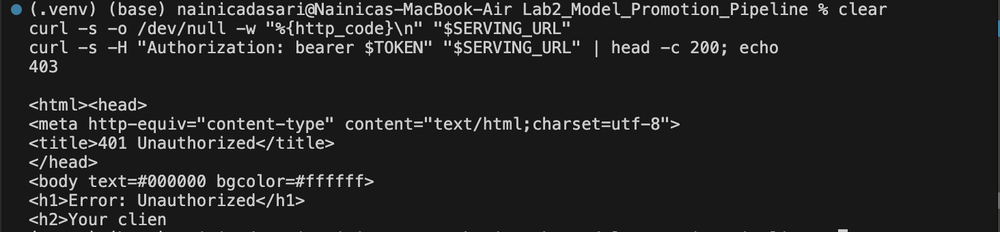

## If something goes wrong

| Problem | What to do |
|---|---|
| `echo $PROJECT_NUMBER` prints nothing | Run the `export PROJECT_NUMBER=...` line again. The permission steps won't work without it. |
| Creating a topic fails with a policy error | The project is too new. Wait a few minutes and try again. |
| A service account "does not exist" | Run the `identity create` commands in Step 4, wait a minute, and try again. |
| Deploying `process-data` fails with a permission error | Permissions are still taking effect. Wait 5 minutes and deploy again. |
| The workflow says it timed out | Check the logs with `gcloud functions logs read process-data --gen2 --region=$REGION` and run the workflow again. |
| curl returns 403 even with a token | The token expired (they last about an hour). Run `TOKEN=$(gcloud auth print-identity-token)` again. |
| The decision log is empty | Messages disappear after they are read once. Run a batch again to create a new message. |
| You want to start over from scratch | Run `gcloud storage rm -r gs://$ARTIFACT_BUCKET/registry gs://$ARTIFACT_BUCKET/models gs://$ARTIFACT_BUCKET/processed`, then run batch_01, batch_02 and batch_03 again in order. |

## Clean up

Deleting the project removes everything created in this lab:

```bash
gcloud projects delete $PROJECT_ID
```
