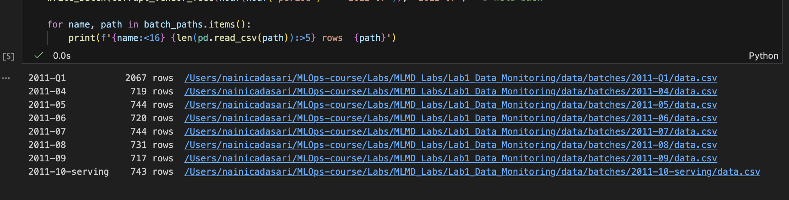
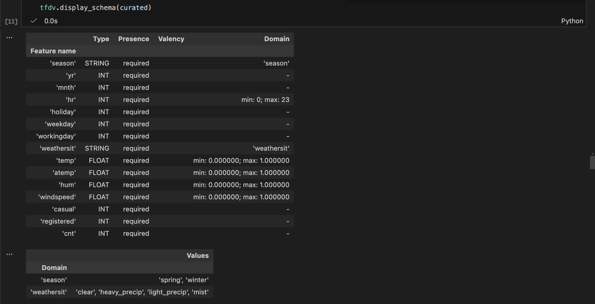
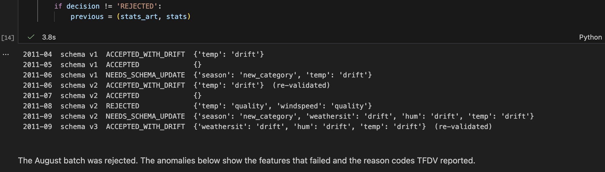
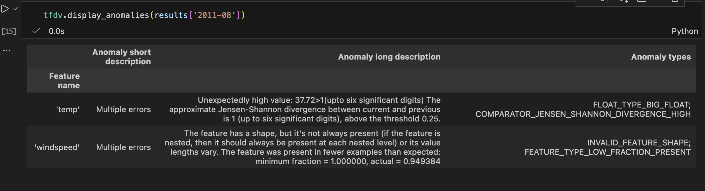
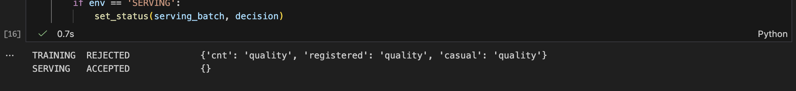
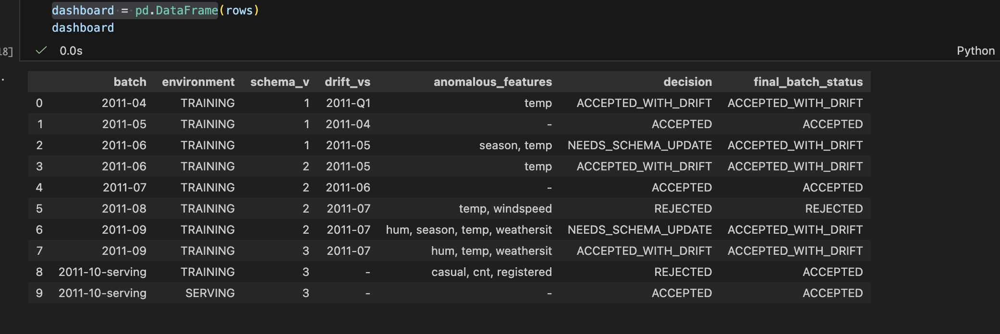
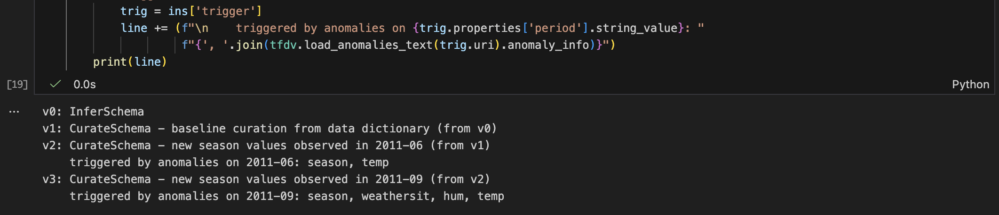
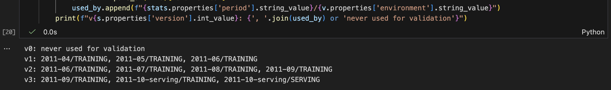

# Lab 1: Monthly Data-Quality Monitoring with TFDV and ML Metadata

## Purpose

In a production ML system, the schema for the training data is defined once, but new data keeps arriving. Every new batch has to be checked before it is used for training: is it valid, has its distribution shifted, and if something looks different, is the data broken or has the world legitimately changed?

Those decisions matter later. When a model misbehaves months afterwards, the team needs to know which batches were accepted, which were rejected and why, and why the schema looks the way it does today. This lab builds a data-monitoring loop that makes those decisions and records every step in an ML Metadata (MLMD) store, so they can be audited from the store alone.

## What the lab does

The lab uses the UCI Bike Sharing dataset (hourly bike rentals in Washington D.C., 2011-2012), split into monthly batches.

1. **Baseline schema.** TFDV infers a schema from January to March 2011 (version 0). The schema is then curated from the dataset's documentation (version 1): value ranges, the full list of weather categories, training and serving environments, and drift thresholds.
2. **Monthly validation.** Each month from April to September 2011 is validated against the current schema and compared with the last accepted month to detect drift.
3. **Decision policy.** Based on TFDV's anomaly reason codes, each batch is:
   - **ACCEPTED**: no anomalies
   - **ACCEPTED_WITH_DRIFT**: valid values, but the distribution moved
   - **REJECTED**: broken data (out-of-range or missing values)
   - **NEEDS_SCHEMA_UPDATE**: a legitimate new value appeared (a new season)
4. **Schema evolution.** When a new season appears (June and September), a new schema version is created and the batch is validated again. Each new version is linked in the store to the anomaly report that triggered it.
5. **Simulated data bug.** August 2011 is corrupted on purpose (temperature sent in Celsius, 5% of windspeed values missing) and should be rejected.
6. **Serving validation.** An October batch without label columns is validated under the training and serving environments.
7. **Audit.** Using only the metadata store, the lab builds a monitoring dashboard, explains why each schema version exists, and lists which batches each schema version validated.

## What gets recorded in the metadata store

| Kind | Name | Purpose |
|---|---|---|
| Artifact | `DataBatch` | A monthly CSV batch, with its final status |
| Artifact | `ExampleStatistics` | TFDV statistics for a batch |
| Artifact | `Schema` | Every schema version, with a content hash |
| Artifact | `ExampleAnomalies` | One validation result and its decision |
| Execution | `GenerateStatistics`, `InferSchema`, `CurateSchema`, `ValidateBatch` | Each step that was run |
| Context | `MonitoringCycle` | Groups everything done for one month |

Events record each artifact's role (`statistics`, `previous_statistics`, `schema`, `trigger`), so lineage queries can tell inputs apart.

## How to run this lab

### Requirements

- Python 3.10. TFDV publishes builds for Python 3.9 to 3.11.
- macOS (Intel or Apple Silicon) or Linux. TFDV does not support Windows natively; on Windows, run the lab inside WSL (Windows Subsystem for Linux).
- Internet access on the first run, to download the dataset (about 1 MB) from the UCI repository.
- Conda (Anaconda or Miniconda) is used below. A standard `venv` with Python 3.10 works the same way.

Tested with `tensorflow-data-validation` 1.21.0 on macOS (Apple Silicon), Python 3.10.

### Step 1: Get the code

```bash
git clone https://github.com/NainicaD/MLOps-Course.git
cd MLOps-Course/Labs/MLMD_Labs/Lab1_Data_Monitoring
```

### Step 2: Create the environment

```bash
conda create -n mlmd python=3.10 -y
conda activate mlmd
python -m pip install --upgrade pip
python -m pip install "tensorflow-data-validation==1.21.0" ml-metadata ipykernel
```

This installs TFDV, TensorFlow, ML Metadata and pandas. Check the install:

```bash
python -c "import tensorflow_data_validation as tfdv, ml_metadata; print('TFDV', tfdv.__version__)"
```

Warnings like `FutureWarning: You are using a non-supported Python version` come from Google client libraries and can be ignored.

### Step 3: Run the notebook

**In VS Code** (with the Python and Jupyter extensions):

1. Open the `Lab1_Data_Monitoring` folder.
2. Open `Lab_Data_Monitoring_MLMD.ipynb`.
3. Click **Select Kernel**, then **Python Environments**, then **mlmd**.
4. Click **Run All**.

**In Jupyter**, from the `Lab1_Data_Monitoring` folder:

```bash
python -m pip install notebook
jupyter notebook Lab_Data_Monitoring_MLMD.ipynb
```

Then choose **Run → Run All Cells**.

Run the notebook from inside `Lab1_Data_Monitoring`: all paths are relative to this folder. A full run takes a few minutes. Each run deletes and rebuilds the metadata store, so results are reproducible.

### Files created by a run

These are excluded from Git by `.gitignore` and are recreated on every run:

| Folder | Contents |
|---|---|
| `raw/` | Downloaded `hour.csv` |
| `data/batches/` | One CSV per batch |
| `artifacts/` | Statistics, schema versions and anomaly reports |
| `metadata/monitoring.sqlite` | The ML Metadata store |

### Expected results

The last cell runs assertions on the results and should print `All validation checks passed`. The key outcomes are:

| Batch | Expected decision |
|---|---|
| 2011-06 | NEEDS_SCHEMA_UPDATE, then accepted on schema v2 (new season: summer) |
| 2011-08 | REJECTED (`temp` out of range, `windspeed` missing values) |
| 2011-09 | NEEDS_SCHEMA_UPDATE, then accepted on schema v3 (new season: fall) |
| 2011-10 serving | REJECTED under TRAINING (labels missing), ACCEPTED under SERVING |

The other months are ACCEPTED or ACCEPTED_WITH_DRIFT, depending on how much temperature and humidity shift from the previous month.

The results can also be checked outside the notebook, from the `Lab1_Data_Monitoring` folder:

```bash
# Each schema version adds exactly one season
diff artifacts/schemas/schema_v1.pbtxt artifacts/schemas/schema_v2.pbtxt
diff artifacts/schemas/schema_v2.pbtxt artifacts/schemas/schema_v3.pbtxt

# The rejected batch lists only temp and windspeed
grep -A 1 "anomaly_info" artifacts/anomalies/2011-08_training_v2.pbtxt | grep "key"

# Executions recorded in the metadata store
sqlite3 metadata/monitoring.sqlite "SELECT t.name, COUNT(*) FROM Execution e JOIN Type t ON e.type_id = t.id GROUP BY t.name;"
```

The expected execution counts are CurateSchema 3, GenerateStatistics 8, InferSchema 1 and ValidateBatch 10.

### Troubleshooting

| Problem | Fix |
|---|---|
| `No matching distribution found for tensorflow-data-validation` | Check `python --version` is 3.9 to 3.11, and that pip runs inside the `mlmd` environment (`which python` should point to it). |
| VS Code asks to install `ipykernel` | The notebook is using a different Python. Select the **mlmd** kernel. |
| The dataset download fails | Download the zip from https://archive.ics.uci.edu/dataset/275/bike+sharing+dataset and place `hour.csv` in a `raw/` folder inside `Lab1_Data_Monitoring`. The notebook skips the download when the file exists. |

## Outputs

### Monthly batches


### Curated schema (version 1)


### Monitoring loop decisions


### Anomalies in the rejected August batch


### Serving batch validated under each environment


### Monitoring dashboard (built from the metadata store)


### Why each schema version exists


### Batches validated by each schema version


## Dataset

Fanaee-T, H. (2013). Bike Sharing [Dataset]. UCI Machine Learning Repository. https://doi.org/10.24432/C5W894 (CC BY 4.0).